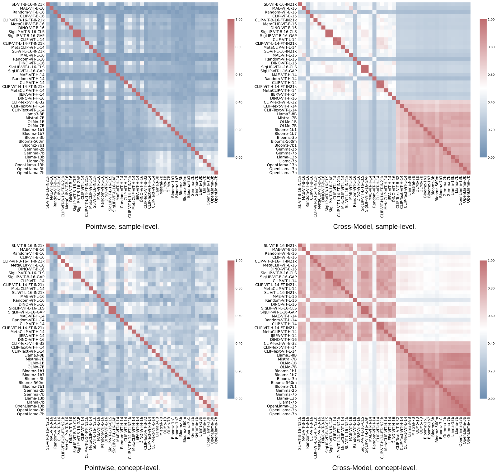

# Displacement Geometry

Code for *Displacement Geometry Captures Platonic Shared Reality Across Models
and Modalities*.

Independently trained models converge on a shared Platonic representation,
captured by the directions between samples in representation space. Across 44
vision and language encoders, we find that displacement geometry is preserved
under a single orthogonal alignment per model pair, even when pointwise locations
differ. This geometry is supported by parallel concept displacements across models
and approximately orthogonal parent–child variations within each model. A
label-free decomposition separates linearly shared semantics from private
capability components.

These findings motivate **Shadow Casting**: cache a frozen source model's features
once, then train lightweight modules to transfer its capabilities. Our
**ShadowCLIP** instantiation combines frozen CLIP and DINO representations with
relational supervision from an LLM teacher.

[Paper](https://arxiv.org/abs/2609.24209) ·
[Project page](https://helloscm.github.io/Platonic_Representation_Displacement/)

[](assets/model_similarity.svg)

All-to-all similarity across 44 models. Top: sample level. Bottom: concept level.
Left: Pointwise. Right: Cross-Model. Click the image to inspect the full matrices.

## Preparation

Use Python 3.10 or newer. Run all commands from this directory and set the path
variables in the examples to your own data, model, and output locations.

```bash
pip install -r requirements.txt
python -m nltk.downloader wordnet
```

The WordNet corpus supplies concept hierarchies. The optional `llm2vec-gen`
package is needed only when extracting LLM2Vec-Gen teacher features; install it
in its supported dependency environment.

`representation/` extracts vision and language features, computes concept
centroids, and fits or applies PCA and whitening. A JSON/JSONL manifest contains
a unique `id` and an `image` path and/or `text` for each record. Relative image
paths are resolved against `--image-root`.

```bash
python -m representation vision \
  --dataset manifest --input "$MANIFEST" --image-root "$IMAGES" \
  --model "$VISION_MODEL" --layers all --output "$VISION_FEATURES" --device cuda:0

python -m representation language \
  --dataset manifest --input "$MANIFEST" --model "$LANGUAGE_MODEL" \
  --layers all --output "$LANGUAGE_FEATURES" --device cuda:0 --dtype bfloat16

python -m representation centroids --input "$VISION_FEATURES" --output "$CONCEPT_FEATURES"

python -m representation fit --input "$FEATURE_MATRIX" --indices "$FIT_INDICES" \
  --method pca-whiten --dim 500 --output "$PREPROCESSOR"
python -m representation transform --input "$FEATURE_MATRIX" \
  --params "$PREPROCESSOR" --output "$PROCESSED_MATRIX"
```

`--layers all` stores complete transformer blocks; `--layers final` stores the
final pooled representation. Feature stores retain row IDs and extraction
metadata. Metric commands fit PCA and whitening internally on their fitting
split, so supply raw features to those commands.

For ShadowCLIP, extract final features with the following settings. Each caption
or prompt must have its own record and ID.

| Features | Extraction settings |
| --- | --- |
| CLIP image/text | `vision` / `language --backend openclip --model "$CLIP_MODEL" --pretrained "$CLIP_WEIGHTS" --layers final` |
| DINO image | `vision --backend timm --model "$DINO_MODEL" --layers final` |
| LLM teacher text | `language --backend llm2vec --model "$LLM2VEC_MODEL" --layers final --max-length 512` |

CLIP caches retain pre-projection features and the original projection matrices.
Use matched Base or Large CLIP/DINO backbones. All training commands in
`dynamics`, `decomposition`, and `shadowclip` accept `--gpus` for single-machine
multi-GPU execution; `--batch-size` is per GPU. Use `python -m <module> --help`
or a subcommand's `--help` for all options.

## Cross-model parallelism

**Paper:** Sections 3, 4.1, 4.3, 4.4; Appendices A.1 and C.

`metric/parallelism/` fits orthogonal Procrustes alignment and evaluates Pointwise,
Cross-Object, and Cross-Model similarity at sample and concept levels. Selecting
all layers evaluates every layer pair.

```bash
python -m metric parallelism --a "$SAMPLE_A" --b "$SAMPLE_B" \
  --level sample --output "$SAMPLE_METRICS" --plot

python -m metric concepts --vision "$VISION_CONCEPTS" --language "$LANGUAGE_CONCEPTS" \
  --output "$CONCEPT_MAP"
python -m metric parallelism --a "$CONCEPT_A" --b "$CONCEPT_B" \
  --level concept --concept-map "$CONCEPT_MAP" --output "$CONCEPT_METRICS" --plot

python -m metric aggregate --inputs "$PAIR_RUN_1" "$PAIR_RUN_2" \
  --output "$METRIC_SUMMARY"
```

Sample stores use matched Flickr30k IDs. Concept stores use ImageNet-22K
centroids and CommonWords79k concepts, matched through the shared concept map.
Defaults are 10,000 fitting items, 10,000 disjoint evaluation items, 500 dimensions,
and 10,000 unordered evaluation pairs. Set `--layers-a`, `--layers-b`, or `--dim`
to select layers or dimensionality.

## Within-model concept orthogonality

**Paper:** Section 4.2; Appendix A.4.

`metric/orthogonality/` measures parent–child, sibling, and parent–child increment
geometry, with parent and random-reference conditions.

```bash
python -m metric orthogonality --input "$CONCEPT_FEATURES" \
  --hierarchy "$HIERARCHY" --parent-store "$PARENT_FEATURES" \
  --output "$ORTHOGONALITY_OUT" --plot
```

The hierarchy maps concept IDs to their direct parents. Parent vectors must be
actual encoded concept features; `--parent-store` can be omitted when they are
already in the input store. A shared concept map can resolve language aliases.
Use `--reference parent`, `random`, or `both` to select the comparison.

## Training dynamics

**Paper:** Section 4.5; Figure 6.

`dynamics/` tracks representation geometry during fine-tuning, supervised training
from scratch, feature distillation (FKD), and relational distillation (RKD).
The six settings use ImageNet-1K for training and Flickr30k for geometry tracking.

```bash
data_args=(
  --train-dir "$IN1K_TRAIN" --val-dir "$IN1K_VAL"
  --metric-dataset flickr30k --metric-input "$FLICKR_CAPTIONS"
  --metric-image-root "$FLICKR_IMAGES" --gpus 0,1 --dtype bfloat16 --plot
)

python -m dynamics finetune "${data_args[@]}" --output "$FINETUNE_OUT"
python -m dynamics distill "${data_args[@]}" --loss rkd --output "$RKD_OUT"
python -m dynamics distill "${data_args[@]}" --loss fkd --output "$FKD_OUT"
python -m dynamics scratch "${data_args[@]}" --loss ce --output "$SCRATCH_OUT"
python -m dynamics scratch "${data_args[@]}" --loss rkd --output "$SCRATCH_RKD_OUT"
python -m dynamics scratch "${data_args[@]}" --loss fkd --output "$SCRATCH_FKD_OUT"
```

Fine-tuning starts from CLIP ViT-B/16; pretrained distillation uses a supervised
ViT-B/16 student and CLIP teacher. Scratch settings use a random ViT-S/16 student,
with a supervised ViT-B/16 teacher for distillation. Defaults are 10 epochs for
pretrained settings and 100 for scratch. Override models or weights through
`--student`, `--teacher`, and their checkpoint arguments.

```bash
python -m dynamics resume --checkpoint "$DYNAMICS_CHECKPOINT" --gpus 0,1
```

## Shared/private decomposition

**Paper:** Section 4.6; Figure 7; Appendix C.

`decomposition/` jointly aligns models with GPA, ranks directions by cross-model
agreement, and evaluates shared/private components using displacement similarity,
linear probing, and normalized HSIC.

```bash
python -m decomposition fit --inputs "$TRAIN_A" "$TRAIN_B" \
  --names A B --layer final --output "$DECOMP" --gpus 0

python -m decomposition analyze --params "$DECOMP" --inputs "$VAL_A" "$VAL_B" \
  --level concept --output "$DECOMP_ANALYSIS" --gpus 0 --plot

python -m decomposition probe --params "$DECOMP" --inputs "$VAL_A" "$VAL_B" \
  --output "$PROBE_OUT" --gpus 0,1 --plot

python -m decomposition transform --params "$DECOMP" --model A --input "$VAL_A" \
  --component shared --rank 100 --space original --output "$SHARED_FEATURES"
```

Supply final-feature stores in the same model order throughout. Training and
evaluation IDs must be disjoint. Concept analysis and probing require `concept`
or `label` annotations. `--ranks` controls the dimension sweep; `--component`
selects `shared` or `private`, and `--space` selects component coordinates or
reconstructed original-space features.

## ShadowCLIP

**Paper:** Section 5; Appendix E.

`shadowclip/` trains gated visual and language residuals from frozen CLIP, DINO,
and LLM features. It includes projection-only and no-RKD ablations, zero-shot
classification, image–text retrieval, and MMVP evaluation.

Pack matched CC12M features and initialize language whitening using ImageNet-1K
training-set reference features:

```bash
python -m shadowclip cache --clip-vision "$CC12M_CLIP_VISION" --dino "$CC12M_DINO" \
  --clip-text "$CC12M_CLIP_TEXT" --teacher "$CC12M_TEACHER" --output "$TRAIN_CACHE"

python -m shadowclip cache --clip-text "$IN1K_TRAIN_CLIP_TEXT" \
  --teacher "$IN1K_TRAIN_TEACHER" --output "$WHITENING_REFERENCE"
python -m shadowclip whiten --input "$WHITENING_REFERENCE" --output "$WHITENING_FILE"

python -m shadowclip train --cache "$TRAIN_CACHE" --whitening "$WHITENING_FILE" \
  --output "$SHADOWCLIP_OUT" --gpus 0,1,2,3,4,5,6,7 --batch-size 8192 --dtype bfloat16

python -m shadowclip evaluate --checkpoint "$SHADOWCLIP_OUT/shadowclip.pt" \
  --spec "$EVAL_SPEC" --output "$EVAL_OUTPUT" --gpus 0
```

`--cache` accepts multiple training shards. Use `--variant clip-ft` or
`--variant no-rkd` for the ablations; these do not require teacher features or
whitening during training. Resume with `train --resume "$SHADOWCLIP_CHECKPOINT"`.

For evaluation, pack image caches with `cache --clip-vision ... --dino ...` and
text caches with `cache --clip-text ...`, supplying `--output` for each. Create an
evaluation JSON file and replace the cache placeholders with your paths:

```json
[
  {"name":"imagenet1k","task":"classification","images":"IMAGE_CACHE","texts":"PROMPT_CACHE","average":"sample"},
  {"name":"coco","task":"retrieval","images":"IMAGE_CACHE","texts":"CAPTION_CACHE"},
  {"name":"mmvp","task":"mmvp","images":"IMAGE_CACHE","texts":"CAPTION_CACHE"}
]
```

Classification records share `class_id`, `concept`, or `label` values; retain one
prompt per record. Retrieval captions link to image IDs through `image_id`.
MMVP records also carry `pair_id`, with two images and two captions per pair.
Cache paths can be absolute or relative to the JSON file. The exported model
supports inference through `shadowclip.inference.Encoder`, using frozen CLIP and
DINO backbones.

## Synthetic concept geometry

**Paper:** Appendix A.2; Figure 9.

`influence/relationship/` constructs synthetic concept hierarchies and measures
sample-level geometry while varying concept parallelism, cross-model offsets,
and parent–child increment angles.

```bash
python -m influence relationship --output "$RELATIONSHIP_OUT"
```

Use `--simulation parallelism` or `--simulation orthogonality` for one sweep.
`--coupling 0` runs the angle sweep with no cross-model increment perturbation.

## Synthetic whitening

**Paper:** Appendix C; Figure 11.

`influence/whitening/` generates additive, noisy, and missing-concept
representations, applies whitening, and measures additive reconstruction R².

```bash
python -m influence whitening --output "$WHITENING_OUT"
```

Use `--seed` to select the synthetic data. Both synthetic experiments save their
generated data and plots. Regenerate plots with
`python -m influence plot --input "$EXPERIMENT_OUT"`.

## Citation

If you find this work useful, please cite our paper:

```bibtex
@article{shang2026displacement,
  title         = {Displacement Geometry Captures Platonic Shared Reality Across Models and Modalities},
  author        = {Shang, Chenming and Tang, Yujin and Ouyang, Junjie and
                   Xu, Ruize and Breuer, Adam and Singh, Nikhil},
  journal       = {arXiv preprint arXiv:2609.24209},
  year          = {2026},
  eprint        = {2609.24209},
  archivePrefix = {arXiv},
  primaryClass  = {cs.LG},
  doi           = {10.48550/arXiv.2609.24209},
  url           = {https://arxiv.org/abs/2609.24209}
}
```
